<div align="center">



<br><br>

<a href="https://github.com/rahulghosh111111/Personal-Assistant-releases/releases/latest"></a>
<a href="https://github.com/rahulghosh111111/Personal-Assistant-releases/releases"></a>


<p>
<a href="#get-it"><b>Get it</b></a> ·
<a href="#how-it-works"><b>How it works</b></a> ·
<a href="#talk-to-it"><b>Talk to it</b></a> ·
<a href="#click-anything-on-screen"><b>Click anything</b></a> ·
<a href="#the-app"><b>The app</b></a> ·
<a href="#safety-and-privacy"><b>Safety</b></a> ·
<a href="#for-developers"><b>Developers</b></a>
</p>

</div>

**Ira** is a voice-locked desktop assistant for Windows. It starts quietly with Windows; say
**“open assistant”** and it answers **“Yes boss, I'm here to listen to you”** (your voiceprint is the
key). Then you just talk to it, in English, Hindi, Bengali or a mix of them, until you say **“quit”**.

It opens apps, plays music, sets the volume, types, clicks buttons by name, sets reminders, reads you
a morning brief and more. Speech recognition, the voices and the voiceprint all run on your PC;
nothing you say leaves it.

<table>
<tr>
<td width="33%" valign="top">

**🔐 Voice-locked**<br>
Only “open assistant” in *your* voice wakes it. Anyone else in the room, or the TV, gets silence.

</td>
<td width="33%" valign="top">

**🗣️ Three languages**<br>
English, Hindi, Bengali or a mix, casual and rural spellings included. Understood by meaning, not exact words.

</td>
<td width="33%" valign="top">

**⚡ Quick**<br>
About 1.2 s from your last word to the first sound of an English reply, on a laptop with no graphics card.

</td>
</tr>
<tr>
<td width="33%" valign="top">

**🖱️ Clicks anything**<br>
“click subscribe”, “the second link”, “in Spotify click play”. Any app, any browser.

</td>
<td width="33%" valign="top">

**🛡️ One safety gate**<br>
Risky actions are read back and confirmed; shutdown needs Windows Hello. “undo that” reverts the last 20.

</td>
<td width="33%" valign="top">

**📴 Works offline**<br>
Everything local keeps working by voice and by typing. Only weather, web search and email need the internet.

</td>
</tr>
</table>


## Get it

> [!IMPORTANT]
> **Ira is shared by invitation.** Every release on this page is encrypted (AES-256-GCM) and signed.
> It opens only in a copy its owner invited, and that copy keeps itself up to date from here.
> Not for public use; all rights reserved.

**If you have an invited copy:**

1. **Install.** Double-click `installer\Install.bat`. No administrator rights are needed. It installs
   on the signed python.org Python with hash-checked packages, and adds Start menu and desktop
   shortcuts and an entry in **Settings > Apps** (uninstall from there; it asks whether to keep your data).
2. **Set up.** The first start opens the setup wizard: microphone, language, model downloads, your
   voiceprint (you read a few sentences aloud), an optional typed passphrase, and a Windows Hello
   test. Run it again any time from the tray > **Set up…**.
3. **Talk.** Say **“open assistant”**.

Updates arrive by themselves, signed, and you can go back to the previous version.

<details>
<summary><b>What's in each release</b></summary>
<br>

| File | What it is |
|---|---|
| `personal-assistant-<version>.zip.enc` | The app, encrypted with AES-256-GCM (about 9 MB) |
| `manifest.json` | The version, size and SHA-256 of the package, and which key it is encrypted for |
| `manifest.json.sig` | The signature the app checks before it installs an update |

</details>

<details>
<summary><b>From the source (developers)</b></summary>
<br>

```powershell
setup.bat                                 # or: uv pip install -p .venv -r requirements.lock
.venv\Scripts\pythonw -m app              # run (GUI)
.venv\Scripts\python main.py              # the same app, from a console
```

</details>


## How it works



<details>
<summary>Text version</summary>

```
sign in to Windows ──► it starts in the background: no window, no sound, just the tray icon
"open assistant" (or "ira kholo" / "ira khulo"), in your voice
      ──► "Yes boss, I'm here to listen to you."
      ──► it listens all the time, no wake phrase needed
            your voice + a command      ──► done, within about a second or two
            someone else / the TV       ──► ignored, silently
            you chatting with a friend  ──► ignored, silently ("Not a command" in the status line)
"quit" / "bye ira" / "stop bro" / Ctrl+L, or the laptop goes to sleep
      ──► back to waiting quietly for "open assistant"
```

</details>

- **Waking it.** While it waits, it says nothing to anyone, whatever is said in the room. Only
  “open assistant” in your voice wakes it. A near miss gets one more try (“Almost. Say a little
  more.”); someone else saying the phrase counts as a failed attempt, and 3 failures block voice
  unlock for 2 minutes (it survives restarts). The phrase, the greeting and the mode are in Settings:
  Security > “Wake-up phrase” / “Unlock by voice with” (`phrase`, `voice`: anything you say, or
  `access_word`), General > “What it says when it wakes up”.
- **Staying with you.** It doesn't lock itself when you go quiet (Settings > General > “Lock after
  this many seconds of quiet”, 0 = never). It goes back to waiting when you quit or the laptop sleeps.
- **The window.** Starting with Windows shows no window; open it from the tray, the Start menu or
  the orb whenever you want it.
- **Listening.** While unlocked it listens continuously and acts only on your voice and only on
  commands. Settings > Voice > “Listening while unlocked: wake” brings back “hey ira” /
  <kbd>Ctrl</kbd>+<kbd>Alt</kbd>+<kbd>J</kbd> with a short follow-up window instead.
- **Interrupting.** Start talking while it speaks (with a headset), or say “hey ira” (on speakers).
- **Privacy mode** (tray > Mute microphone, or <kbd>Ctrl</kbd>+<kbd>Shift</kbd>+<kbd>P</kbd>) stops
  listening until you resume it.
- **Offline.** Everything local keeps working by voice and by typing. Commands that need the
  internet (weather, web search, email) answer “I'm offline”.

### Speed



It first uses a fast recognition model and, only when that didn't produce a command, re-checks with
the more accurate one. It treats 0.45 s of silence as the end of your sentence. In Bengali, the voice
is the slow part. Settings > Voice > “Recognition speed” trades speed for accuracy (`fast` / `accurate`).


## Talk to it

Everyday phrasing in all three languages works, including casual and rural spellings:

| | English | Hindi / Hinglish | Bengali |
|---|---|---|---|
| 🪟 | open chrome · close it · switch to word | notepad khol do · chrome band karo | notepad kholo · chrome bondho koro |
| 🔊 | turn it down a bit · make it louder · mute | awaz thoda kam karo · awaaj badha do | awaj komao · awaj barao |
| 🎵 | put some music on · skip this song · pause | gaana laga do · agla gaana chalao · gaana band karo | gaan chalao · porer gaan · gaan bondho koro |
| 🕒 | what time is it right now · what's the weather | kitne baje hain · aaj mausam kaisa hai | kota baje · ajker abohawa kemon |
| ⏰ | remind me in 10 minutes to stretch | das minute baad paani peene ki yaad dilana | — |
| 💬 | how are you · who are you · well done · good night | kaise ho · kya haal hai · tum kaun ho · bahut badhiya | kemon acho · ki khobor · tomar naam ki · khub bhalo |

> [!TIP]
> Say **help** for the full list. Say **stop bro** to stop everything and send it back to waiting.

#### Say it your way <sup>`1.10`</sup>

You don't have to use the exact words. “Can you lower the sound”, “गाना थोड़ी देर रोक दो”, “make this
window full screen” are understood by meaning in a few milliseconds; if it's only fairly sure it asks
“Did you mean…?”, and remembers your phrase when you say yes.

#### Follow-ups and “it” <sup>`1.11`</sup>

After a reply it keeps listening for 8 seconds (Settings > Voice).

| You say | Then |
|---|---|
| “open notepad” | “close it” |
| “search for flights to goa” | “open the second one” / “দ্বিতীয়টা খোলো” |
| “message ravi on whatsapp see you at five” | “do the same for rahul” |
| anything | “again” / “phir se” / “abar” · “what did you just open?” · “forget this conversation” |

“thanks”, “bas”, “thik ache” end the follow-up.

#### Your files <sup>`1.12`</sup>

Off until you switch it on in Settings > Files. “find the PDF about my car insurance” → the top 3
files → “open the first one”; “what's the due date on my electricity bill?”; “summarise this page /
this PDF / my unread emails / this”, “… in one line”, “… in detail”.

#### More

`take a screenshot` · `open youtube and play lofi` · `search for cheap flights` · `read my emails` ·
`send email to [name]` · `type hello` · `click OK` · `type hello into the search box` ·
`tick remember me` · `minimize all` · `reopen closed tabs` · `take a note …` · `lock computer` ·
`sleep` · `shutdown` / `restart` / `log off` (confirmed, with Windows Hello) · `undo that` ·
`privacy mode` · **`stop bro`**

### While something is running <sup>`2026-11-03`</sup>

It keeps listening while a command runs; commands wait their turn in a queue.

| Say | What happens |
|---|---|
| **stop** · **cancel** · ruko · bas | Stops the running command, empties the queue, stops talking: “Okay, stopped.” (With nothing running, “stop” still pauses the music.) |
| **stop talking** · **quiet** · shut up · chup | Stops the talking only; the command carries on. |
| a new command, under 10 s into the last one | “Got it, I'll do that next.” |
| a new command, 10 s or more into the last one | “I'm still working on your last command: … Skip it and start …? Yes or no?” **Yes** (yes, okay, skip, go ahead, haan): stops it now and starts the new one. **No** (no, wait, continue, finish it, nahi) or no answer: finishes it, then the new one next. |
| **stop bro** · quit | Stops everything and goes to sleep (as before). |

A command that runs longer than 75 seconds is stopped and you're told (`command_timeout_s`). The word
lists and times are in `config.json`: `task_yes_words`, `task_no_words`, `task_stop_words`,
`task_quiet_words`, `task_interrupt_after_s` (10), `task_answer_timeout_s` (8).


## Click anything on screen

<sup>`2026-11-03`</sup> Works in any app and in browsers: UI Automation first, the page itself in the
assistant's own browser, and OCR for apps that can't be read any other way.

| Say | What happens |
|---|---|
| click **how to learn** | Clicks “How to learn Python in 30 days”: the first three words of a label are enough. Close spellings work (“log in” = “login”, “2” = “two”). |
| press **subscribe** · click on **read more** · open **how to learn** (not an app) | The same. |
| click subscribe, when there are two | “I found 2 ‘Subscribe’ buttons: one at the top and one at the bottom. Which one?”, numbered on screen meanwhile. Answer: top / bottom / left / right / top left / first / second / number 2 / last / the one in the sidebar. |
| click **the first link** · **the second button** · **the button at the top right** · **the last tab** | By position only. |
| click **the search bar** | The field called Search. |
| **in Spotify click play** · click play in Spotify | Brings Spotify to the front first. |
| click something it can't find | “I couldn't find ‘profile’. Did you mean A, B or C?” Your answer is clicked and remembered for that app (`click_aliases.json` in the data folder; you can add your own names there). |
| click anything named Delete, Remove, Pay, Buy, Send, Submit, Confirm, Uninstall, Format, Sign out… | “Are you sure? Yes or no.” first (`click_confirm_words`). |

> [!NOTE]
> A window running as administrator can't be read by a normal program; it says so.

**Your own phrases:** Settings > Custom commands (open an app or a website, a shell command, or a
sequence of steps). Phrases it gets wrong show up in Activity > This week, where you can turn them
into test cases.


## The app

<table>
<tr>
<td width="50%"></td>
<td width="50%"></td>
</tr>
<tr>
<td align="center"><sub>The window: what it heard, what it said, and a box for typed commands</sub></td>
<td align="center"><sub>Window closed: the floating orb stays, bottom right</sub></td>
</tr>
</table>

- **Window:** the conversation, a box for typed commands (or your passphrase when locked), and an
  action card for everything it did, with **Undo** where it can be undone.
- **Floating orb:** shows listening / thinking / speaking and your mic level; click to talk,
  double-click to open the window, drag to move it. It hides behind full-screen apps.
- **Tray:** show the window, mute the microphone, lock, show the orb, set up, quit.
- **Activity:** everything it did, from the encrypted log, with filters. The **This week** tab
  shows commands it didn't understand, your corrections and slow steps.
- **Settings:** General, Voice, Microphone, Proactive, Security, Privacy, Updates, Safety (per
  command: ask / don't ask / block), Custom commands, Contacts, Plugins. The interface is in English,
  Hindi or Bengali, light or dark.

<details>
<summary><b>☀️ Proactive</b>: morning brief, meeting reminders, email alerts (all off until you turn them on)</summary>
<br>

Settings > Proactive.

- **Morning brief** at your time: today's meetings, reminders, the weather, unread email.
- **Meeting reminders** from your calendar's secret iCal link (Google or Outlook.com), with a Join
  button for Teams / Zoom / Meet.
- **Email alerts** from people you mark as important.
- **Quiet hours**, and it waits while you present or are on a call. Ask “what did I miss?” or
  “why did you tell me this?” at any time.

</details>

<details>
<summary><b>🧩 Plugins</b>: Notes, Media, WhatsApp and your own</summary>
<br>

Settings > Plugins. Plugins add commands and are installed from a `.zip` after a permissions prompt.
Each one runs as its own program, and everything it does goes through the same safety checks as
built-in commands. Plugins signed by someone other than Ira Assistant get a warning; unsigned ones are
refused unless developer mode is on.

First-party examples (build them with `scripts\build_plugins.py`): **Notes** (“read my notes”),
**Media** (“what's playing”, “spotify lofi beats”) and **WhatsApp** (“message Mum on WhatsApp hello”,
always read back and confirmed).

</details>

<details>
<summary><b>🎙️ Audio</b>: phone-call quality, tuned for laptop speakers</summary>
<br>

| | Phone call (HD voice) | This assistant |
|---|---|---|
| Sample rate | 16 kHz | 16 kHz (what the speech and voiceprint models expect) |
| Low-cut filter | 80–100 Hz | 100 Hz (Settings > Microphone) |
| Echo cancellation, noise suppression | on | on |
| Automatic gain | on | optional (Settings > Microphone; helps if you sit far away) |

“Clearer voice on laptop speakers” (Settings > Voice, on by default) cuts the rumble small speakers
can't play, lifts the speech range and keeps every sentence equally loud.

</details>


## Safety and privacy



- **Every action goes through one safety gate.** Each command has a risk level, and the risky ones are
  read back and confirmed by voice or with the window's Yes / No (No is the default). Shutdown,
  restart and log off also need Windows Hello. Settings > Safety lets you allow or block single commands.
- **Undo:** “undo that” or a card's Undo button reverts the last 20 actions for 10 minutes.
- **Encryption:** the voiceprint, the activity log's details and scheduled reminders are encrypted
  with AES-256-GCM. The calendar link is kept in Windows Credential Manager.
- **Local by default:** speech recognition and the voices run locally. Crash reports stay on the
  PC, scrubbed of paths, names, emails and anything you said (Settings > Privacy).
- **Replays and fake voices** <sup>`1.13`</sup>: unlocking and risky spoken actions check that the voice
  is live: a recording of an earlier unlock is caught by its fingerprint, and when it's unsure it asks
  you to say a random phrase (“say: blue forty-seven”). Critical actions always ask for one.
- **Family and guests** <sup>`1.13`</sup> (Settings > People / Security): members get their own voiceprint
  and limits (never shutdown, programs or settings; your files only if you allow it). Guest mode
  (off by default) lets voices it doesn't know ask the time, the weather or a general question and
  control music, nothing else. The roles are enforced in the safety gate, and Activity shows who did what.
- **Your files, safely:** the file index is encrypted, keyword search uses keyed hashes (no words on
  disk), password / key files and sensitive names are never read, and the model that answers or
  summarises has no tools: text in a document (“ignore previous instructions…”) can only ever become
  words in a summary.
- **Email reading** needs `"imap": {"host": "...", "user": "...", "password_env": "ASSISTANT_IMAP_PASSWORD"}`
  in `config.json`, with the password in that environment variable (never stored in the config).
- **Safe testing:** `"dry_run": true` in the config describes actions without performing them.

> [!WARNING]
> Voice biometrics can still be fooled by a good enough clone. Treat voice unlock as a convenience
> lock, not a replacement for your Windows sign-in.

<details>
<summary><b>📁 Where your data lives</b></summary>
<br>

| Folder | Contents |
|---|---|
| `%APPDATA%\PersonalAssistant` | `config.json`, the encrypted voiceprint, `secret.key`, `access_logs.db` (activity, details encrypted), `scheduler.db` (reminders and the brief), `commands.json`, `latency.jsonl` (timings only, never what you said), `eval_cases.jsonl`, `plugins\` and `plugin-data\` |
| `%APPDATA%\PersonalAssistant`, since 1.10–1.13 (all encrypted) | `semantic_learned.enc` (phrases you confirmed), `file_index.db` (only with file search on), `people.enc` + `voice_<id>.enc` (members), `replay_prints.enc` (fingerprints, never audio), `planner_state.json` |
| `%LOCALAPPDATA%\PersonalAssistant\Logs` | `assistant.log`, `ui.log`, `crashes\` (scrubbed problem reports) |
| `%LOCALAPPDATA%\PersonalAssistant\Cache` | downloaded models (speech, voices, wake phrase) and WordNet |

</details>


## For developers

> [!NOTE]
> These run from the source checkout. This repository holds the encrypted releases only.

```powershell
.venv\Scripts\python -m pytest -q                 # tests (hardware ones need RUN_HARDWARE_TESTS=1)
.venv\Scripts\ruff check .                        # lint
.venv\Scripts\python main.py --check              # dependencies and microphone
.venv\Scripts\python scripts\latency_report.py --bench   # speed on this PC
.venv\Scripts\python scripts\eval_matcher.py      # the command matcher against the test cases
.venv\Scripts\python scripts\i18n_check.py        # missing Hindi / Bengali translations
.venv\Scripts\python -m bench                     # understanding benchmark (reports\bench.md)
.venv\Scripts\python scripts\eval_planner.py --models qwen3:4b,qwen3:1.7b --cases bench\planner_cases.yaml
```

In the source, `CLAUDE.md` has the architecture, every module, the commands and the working rules.
The plans and decisions per phase are in `docs/plans/`, distribution options in
`docs/distribution.md`, and releasing in `docs/releasing.md`.

## Not yet

- 🚧 **The synthetic-voice detector** (AASIST-L) is optional: `scripts\convert_aasist.py` makes it
  from the official weights on a developer PC; without it the replay check and the challenge still work.
- 🚧 **Per-member settings and custom commands:** members share the owner's settings and commands
  (their own limits, voiceprint, file access and conversation memory are theirs).
- 🚧 **A signed installer for other PCs** (Microsoft Store / winget): evaluated in
  `docs/distribution.md` and waiting on a decision.
- 🚧 **macOS:** only a plan; Windows is the platform today.

## License

All rights reserved. The releases are for invited copies only and are not for public use.

<div align="center">
<br>

<br>
<sub><a href="#top">Back to top ↑</a></sub>
</div>
