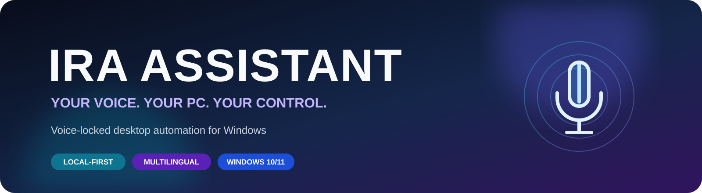
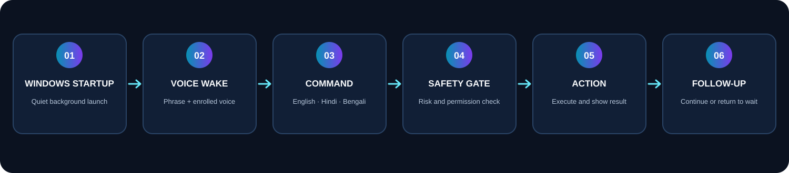
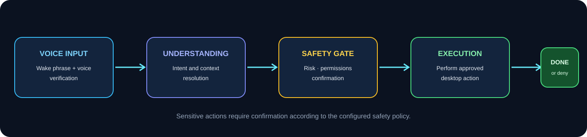

    
<strong>A voice-locked desktop assistant for Windows 10/11</strong>

  
Speak naturally in English, Hindi, Bengali, or a mix. Ira listens for your voice, understands commands, and helps control your PC — with privacy and safety controls built in.
  

    
    
    
    
  
  

    <a href="#-installation">Install</a> •
    <a href="#-features">Features</a> •
    <a href="#-voice-command-examples">Commands</a> •
    <a href="#-privacy--security">Privacy & Security</a> •
    <a href="#-developer-guide">Developers</a>
  

✨ What is Ira Assistant?
Ira Assistant is a Windows desktop voice assistant designed to make everyday PC tasks easier. Start it with Windows, say “open assistant”, and Ira responds:
“Yes boss, I'm here to listen to you.”

After voice verification, you can speak naturally without repeating a wake phrase before every command. Ira can launch applications, control media and volume, interact with on-screen controls, create reminders, search the web, work with supported files, and more.

Core idea: local-first voice interaction, practical desktop automation, and a safety check before sensitive actions.
Important: Voice recognition and voice matching are convenience and access-control features, not a replacement for your Windows account password or Windows Hello. Voice biometrics can be spoofed by sufficiently capable voice cloning.

🖥️ At a glance

  

Area	What it does
Wake and unlock	Recognizes your configured wake phrase and enrolled voice
Languages	English, Hindi, Bengali, and mixed-language phrasing
PC control	Opens apps, types text, changes volume, clicks UI controls, and manages windows
Media	Plays, pauses, skips, and controls supported media workflows
Productivity	Reminders, notes, morning brief, calendar and email features when configured
File assistance	Searches and summarizes supported files when enabled
Customization	Settings, custom commands, plugins, contacts, and language options
Safety	Confirmation gates, command permissions, undo support, and dry-run mode

🚀 Features
🎙️ Voice-first interaction
- Wake phrase support, including configurable phrases.
- Voiceprint-based recognition for the enrolled user.
- Continuous command listening while unlocked.
- Optional typed commands and passphrase support.
- Interrupt speech by speaking or using supported interruption commands.
- Recognition speed setting: fast or accurate.
🌏 Multilingual commands
Ira supports natural command phrasing in:
- English
- Hindi / Hinglish
- Bengali
You do not need to memorize exact command wording. Ira can interpret common variations and ask for clarification when confidence is low.
🪟 Windows automation
- Open and close applications.
- Switch between windows and manage window state.
- Type text and interact with controls.
- Click buttons, links, tabs, and fields by label or position.
- Take screenshots.
- Lock, sleep, restart, shut down, or sign out with required confirmation safeguards.
🎵 Media and everyday tasks
- Start music and control playback.
- Change system volume and mute.
- Ask the time or weather.
- Create reminders.
- Take notes.
- Search the web and open websites.
🧠 Follow-ups and context
Ira can understand short follow-up instructions such as:
- “Open Notepad” → “Close it.”
- “Search for flights to Goa” → “Open the second one.”
- “Again.”
- “What did you just open?”
Follow-up listening is time-limited and configurable.
🖱️ Screen interaction
Ira can locate controls using Windows UI Automation, supported browser-page information, and OCR fallback where available. If several matching controls are found, it can ask which one you mean.

Sensitive actions — such as Delete, Remove, Pay, Buy, Send, Submit, Confirm, Uninstall, or Format — require confirmation according to the configured safety policy.
🔔 Proactive assistance
Optional features can include:
- Morning brief
- Meeting reminders
- Important-person email alerts
- Quiet hours
- Presentation and call-aware waiting
These features are opt-in and may require account or calendar configuration.
🔌 Plugin support
Plugins can extend Ira with additional commands. Plugins are installed from ZIP packages after a permissions prompt and run through the assistant's safety checks. Example plugin areas include Notes, Media, and WhatsApp.
📥 Installation
Option 1 — Install the desktop app (recommended)
1. Download or clone the project release provided by the maintainer.
2. Open the project folder.
3. Double-click:
   installer\Install.bat
4. Follow the installer prompts.
5. Launch Ira Assistant from the Start menu, desktop shortcut, or system tray.
6. Complete the first-run setup wizard.
The setup wizard guides you through microphone selection, language, model downloads, voice enrollment, optional passphrase, and a Windows Hello test.
Installer behavior, automatic updates, package verification, and rollback depend on the installer/release build included with the version you download. Check the release notes for the exact capabilities of that build.

Option 2 — Run from source
Requirements
- Windows 10 or Windows 11
- A supported Python installation
- Microphone and speakers/headphones
- Internet connection for initial dependency/model downloads and online features
Open PowerShell in the project directory:
# Set up the environment and dependencies
setup.bat

# Launch the GUI
.venv\Scripts\pythonw -m app

# Or launch from a console
.venv\Scripts\python main.py
If your project setup uses the locked requirements directly, the documented alternative is:
uv pip install -p .venv -r requirements.lock
First launch checklist
- [ ] Select the correct microphone.
- [ ] Choose your preferred language.
- [ ] Allow required speech and voice model downloads.
- [ ] Enroll your voice by reading the displayed sentences.
- [ ] Configure an optional typed passphrase.
- [ ] Complete the Windows Hello test if prompted.
- [ ] Review Security, Privacy, Voice, and Safety settings.
- [ ] Test with a low-risk command first.
🗣️ Voice command examples
Try these natural phrases after unlocking Ira.
Task	English	Hindi / Hinglish	Bengali
Open an app	Open Chrome	Chrome kholo	Chrome kholo
Close an app	Close it	Chrome band karo	Chrome bondho koro
Lower volume	Turn it down a bit	Awaaz thoda kam karo	Awaj komao
Increase volume	Make it louder	Awaaz badha do	Awaj barao
Play music	Put some music on	Gaana laga do	Gaan chalao
Next song	Skip this song	Agla gaana chalao	Porer gaan
Pause music	Pause	Gaana band karo	Gaan bondho koro
Ask the time	What time is it?	Kitne baje hain?	Kota baje?
Reminder	Remind me in 10 minutes to stretch	Das minute baad yaad dilana	—
Take a screenshot	Take a screenshot	Screenshot lo	Screenshot nao

Useful control phrases
Phrase	Result
help	Shows available command help
stop / cancel	Stops the current operation and clears queued work where supported
stop talking / quiet	Stops speech output while the task continues
stop bro / quit	Ends the active assistant session
undo that	Reverts a supported recent action
privacy mode	Mutes microphone listening until resumed
what did you just open?	Asks about the recent action
forget this conversation	Clears the supported follow-up context

YouTube example
A natural workflow is:
1. Say: “Open YouTube and play lofi music.”
2. Ira searches for the requested music and opens a matching result.
3. To choose a result from a search list, say: “Open the first video” or “Play the second one” only when the results are available in the current interaction context.
The exact behavior depends on the installed command handlers and browser integration.
🧩 How the assistant behaves

  

1. Waiting: Ira stays in the background with its tray icon.
2. Wake phrase: It checks the configured phrase and enrolled voice.
3. Unlocked session: It listens for commands until you quit, lock it, or the computer sleeps.
4. Command understanding: It interprets the request and resolves follow-ups where supported.
5. Safety gate: The action is checked against risk level, permissions, and confirmation rules.
6. Execution: The command runs, and the interface shows an action card where supported.
7. Return to waiting: Ira returns to its waiting state when the session ends.
While a command is running
Commands can be queued. You can ask Ira to stop, stop speaking, or decide whether a new command should replace a longer-running task. Long-running commands have a configured timeout.
🔐 Privacy & Security
Ira is designed around local processing and explicit safety checks.
- Speech recognition, voice matching, and speech output are described as running locally.
- The microphone can be muted through Privacy Mode.
- Risky commands can require read-back and confirmation.
- Shutdown, restart, and log-off require Windows Hello according to the project specification.
- Supported recent actions can be undone for a limited time.
- Voiceprint and selected activity/reminder data are encrypted.
- Calendar credentials are stored in Windows Credential Manager.
- Crash reports are designed to omit spoken content and scrub identifying details.
- File search is opt-in and uses an encrypted index.
- A dry-run setting can describe actions without performing them.
Security recommendations
1. Use a strong Windows sign-in method and keep Windows Hello enabled.
2. Do not treat voice unlock as your only security boundary.
3. Review command permissions in Settings → Safety.
4. Keep privacy mode available when you do not want the microphone active.
5. Install plugins only from sources you trust.
6. Keep the application and its dependencies updated.
7. Do not put passwords, API secrets, or private tokens in config.json.
Dry-run mode
For safe testing, enable the following in the configuration where supported:
{
  "dry_run": true
}
This mode is intended to describe actions rather than execute them. Verify the behavior of the build you are testing before relying on it.
⚙️ Settings and customization
The application provides settings for areas such as:
- General
- Voice
- Microphone
- Proactive features
- Security
- Privacy
- Updates
- Safety
- Custom commands
- Contacts / People
- Plugins
Custom commands can map your own phrases to supported app launches, websites, shell commands, or sequences of steps. Use extra care when creating commands that modify files, send messages, or affect system settings.
📂 Where data is stored
According to the project configuration, user data is stored under these Windows locations:
Location	Examples
%APPDATA%\PersonalAssistant	Configuration, encrypted voiceprint, activity database, reminders, custom commands, plugins and supported indexes
%LOCALAPPDATA%\PersonalAssistant\Logs	Application logs, UI logs and scrubbed crash reports
%LOCALAPPDATA%\PersonalAssistant\Cache	Downloaded speech, voice and language resources

The exact files present vary by application version and enabled features. Back up important user-created configuration before reinstalling or removing application data.
🧑‍💻 Developer guide
Run checks
From the project virtual environment:
# Run tests
.venv\Scripts\python -m pytest -q

# Run lint checks
.venv\Scripts\ruff check .

# Check dependencies and microphone
.venv\Scripts\python main.py --check

# Benchmark local latency
.venv\Scripts\python scripts\latency_report.py --bench

# Evaluate command matching
.venv\Scripts\python scripts\eval_matcher.py

# Check Hindi and Bengali translations
.venv\Scripts\python scripts\i18n_check.py

# Run understanding benchmark
.venv\Scripts\python -m bench
Some hardware-dependent tests require:
$env:RUN_HARDWARE_TESTS = "1"
.venv\Scripts\python -m pytest -q
For planner evaluation, use the model and case names configured in your repository:
.venv\Scripts\python scripts\eval_planner.py --models qwen3:4b,qwen3:1.7b --cases bench\planner_cases.yaml
Project documentation
The source project may include additional developer documentation:
- CLAUDE.md — architecture, modules, commands, and working rules.
- docs/plans/ — phase plans and design decisions.
- docs/distribution.md — distribution options.
- docs/releasing.md — release workflow.
Suggested contribution workflow
1. Create a feature branch.
2. Make a focused change.
3. Add or update tests for the behavior.
4. Run tests and lint checks.
5. Update user-facing documentation when commands or settings change.
6. Open a pull request with a clear summary and test results.
🛣️ Roadmap and current limitations
The project notes identify these areas as not yet complete or not universally available:
- The optional AASIST-L synthetic-voice detector requires a separate developer-side conversion step.
- Per-member settings and custom commands are not fully independent; some settings and commands are shared.
- A signed installer for wider distribution, including Microsoft Store / winget, is still under evaluation.
- macOS support is a plan only; Windows is the current platform.
Check the repository's latest release notes and issue tracker for changes to this list.
❓ Troubleshooting
Problem	What to check
Ira does not wake	Check microphone selection, wake phrase, voice enrollment, and microphone privacy permissions
Ira hears the wrong language	Check the selected language and recognition-speed setting
No sound from Ira	Check Windows output device, application volume, and voice settings
App does not start	Run main.py from PowerShell and inspect the console error
Online command says offline	Check the internet connection and required service configuration
A button cannot be clicked	Make sure the target app is not running elevated; normal processes cannot inspect every administrator-level window
Email feature is unavailable	Configure the supported IMAP settings and environment variable; do not store the password in the config file
Plugin is rejected	Check its signature, developer-mode policy, and requested permissions

For diagnostics, run:
.venv\Scripts\python main.py --check
📦 Commit this README and its images
The graphics in this README are stored inside this repository, not linked to temporary ChatGPT files. This means GitHub can display them after you commit and push the assets folder with README.md.

Your repository should contain:
your-project/
├── README.md
└── assets/
    ├── ira-banner.svg
    ├── ira-workflow.svg
    └── ira-security-flow.svg
Copy the generated README.md into your project root and copy the complete assets folder beside it. Then run:
git add README.md assets/
git commit -m "docs: upgrade Ira Assistant README"
git push
Important: Keep the folder name exactly assets and preserve the relative image paths. Do not commit only the README — commit the SVG files too.

    
<strong>IRA ASSISTANT</strong> · Your voice. Your PC. Your control.

  Built for Windows • Local-first by design • Safety-aware automation

