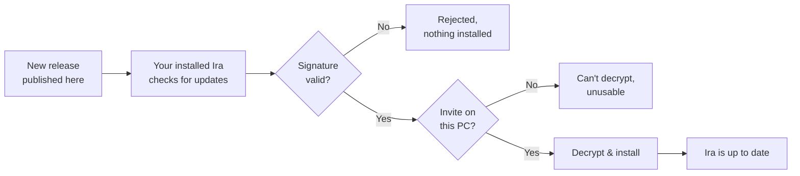

# Ira Assistant — Releases

**A private voice assistant for Windows.**
Signed, encrypted builds, delivered straight to invited installs.

---

> [!IMPORTANT]
> **These files are not for public use.**
> Every release here is encrypted and opens only in a copy of Ira Assistant whose owner has invited you, using an invite file sent to you personally. Downloading the files without an invite gives you nothing usable.

> [!TIP]
> **Did the owner share Ira with you?** Install it from the **zip they sent you**, not from this page. After that, your copy keeps itself up to date from here. You never need to download anything from this repository by hand.

---

## Contents

- [What this repository is](#what-this-repository-is)
- [Screenshots](#screenshots)
- [How updates work](#how-updates-work)
- [Security model](#security-model)
- [Getting access](#getting-access)
- [FAQ](#faq)
- [Copyright](#copyright)

---

## What this repository is

This repository is the **update channel** for Ira Assistant. It is not the source code and not a download page.

| | |
|---|---|
| **What lives here** | Signed, encrypted release packages |
| **Who uses it** | Installed copies of Ira Assistant, automatically |
| **Who it's for** | People the owner has personally invited |
| **What it's not** | A public download, a source repo, or an installer for new users |

---

## Screenshots

<b>Ira Assistant</b>

  

<b>Ira, still there</b>

---

## How updates work

Installed copies check this repository and update **by themselves**. No action is needed from you.

1. A new signed, encrypted build is published to this repository.
2. Your installed copy of Ira notices it.
3. The app **checks the signature**, so only builds from the owner are accepted.
4. The app **decrypts the build** with your personal invite.
5. The update installs, and Ira carries on.

---

## Security model

| Layer | What it does |
|---|---|
| 🔏 **Signed** | Each release is signed by the owner. A tampered or unofficial file is refused. |
| 🔐 **Encrypted** | Release files are encrypted. Without a valid invite they are unreadable. |
| ✉️ **Invite-bound** | Access comes from an invite file issued personally to a named person, for their own use. |
| 🔄 **Self-updating** | Updates come straight from this channel, so invited users stay on the latest version without hunting for downloads. |

---

## Getting access

There's no public sign-up. Ira Assistant is shared **only by personal invitation** from the owner.

- **Have an invite?** Install from the zip the owner sent you. Updates take care of themselves after that.
- **Don't have one?** The files here won't work for you. Please don't redistribute them.

---

## FAQ

<b>Can I download a release from here and install it?</b>

 
No. Releases are encrypted and only open in a copy of Ira that has a valid invite. Install from the zip the owner sent you instead.

<b>Do I need to come back here to update?</b>

 
No. Your installed copy updates itself from this repository.

<b>Can I share my invite or the app with a friend?</b>

 
No. An invite is permission for the person named in it, for their own use only. Ask the owner if someone else wants access.

<b>Is the source code available?</b>

 
No. This repository only hosts release packages for the update channel.

<b>Which platforms are supported?</b>

 
Windows.

---

## Copyright

**Copyright © 2026 Rahul Ghosh. All rights reserved.**

No permission is given to use, copy, modify, share or distribute this software, in whole or in part, without the owner's written permission. An invite counts as permission for the person named in it, for their own use.

 
Ira Assistant · Private · Signed · Encrypted

