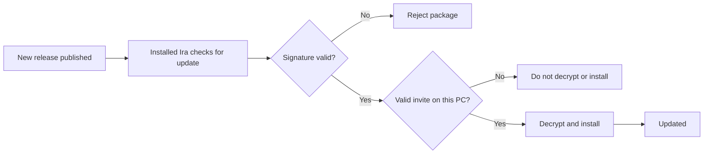

  
  
  
  
  

[!IMPORTANT]
Ira Assistant is distributed privately. The release files in this repository are not intended for unrestricted public use. Access is limited to people who have received a valid invitation from the owner. Releases are described as signed and encrypted; the application should reject packages that fail its verification checks.

[!TIP]
If the owner has invited you: install Ira using the ZIP file shared with you. Do not use a source-code checkout as a substitute for the packaged release. Once installed, the application can check this release channel for updates, provided update access is configured for your copy.

Contents
Getting started	Using Ira	Security and maintenance
Meet Ira	How it works	Safety and privacy
Installation	Voice commands	Updates
First-time setup	Commands while a task runs	Where your data is stored
The app interface	Screen interaction	Known limitations
Proactive features	Plugins	Copyright

🎙️ Meet Ira
Ira Assistant is a voice-controlled desktop assistant for Windows. It can start in the background with Windows and wait for your configured wake phrase. When it recognises the enrolled user's voice, it can respond:
“Yes boss, I'm here to listen to you.”

Ira supports English, Hindi, Bengali and mixed-language commands. Depending on the enabled features and permissions, it can open applications, control media and volume, type text, interact with on-screen controls, create reminders, and provide a morning brief.

Speech recognition, voice output and voiceprint matching are designed to run locally. Some features—such as weather, web search, email, calendar integrations and online content—necessarily communicate with their respective services. Review the privacy and plugin settings before enabling connected features.

<b>Ira Assistant</b>

<b>Ira, still there</b>

📦 Installation
1. Extract the ZIP file shared with you.
2. Open the extracted folder.
3. Double-click installer\Install.bat.
4. Follow the installer prompts. The standard installation is designed not to require administrator rights.
5. When installation finishes, launch Ira from the desktop shortcut, Start menu or system tray.
The installer is described as using a signed python.org Python runtime and hash-checked packages. It also creates Start menu and desktop shortcuts and registers the application under Settings → Apps.
Uninstalling
Open Settings → Apps → Installed apps, select Ira Assistant and choose Uninstall. The uninstaller asks whether you want to keep your application data.
First-time setup
On the first launch, the setup wizard guides you through the following steps:
Microphone
    ↓
Language
    ↓
Required model downloads
    ↓
Voiceprint enrolment (read the displayed sentences)
    ↓
Optional typed passphrase
    ↓
Windows Hello test
You can run setup again from System tray → Set up….
🔄 How it works

Typical interaction:
Sign in to Windows
    └─ Ira starts in the background and displays its tray icon.

Say the configured wake phrase
    └─ “open assistant” (also supports configured variants such as “ira kholo”)
        └─ Ira responds and enters its unlocked listening state.

Speak a command
    ├─ Recognised command → Ira performs the action, subject to safety checks.
    ├─ Other speaker / TV audio → should be rejected by voice matching.
    └─ Unclear speech → Ira may ask you to repeat or clarify.

Say “quit”, “bye ira”, “stop bro” or press Ctrl+L
    └─ Ira leaves the active listening state and returns to waiting.

<b>Wake, listening, privacy mode and offline behaviour</b>
- Wake phrase: While locked, Ira waits for the configured wake phrase and enrolled voice. A near-match may prompt you to try again. The README's current behaviour specifies that three failed voice-unlock attempts temporarily block voice unlock for two minutes, including across restarts.
- Stay unlocked: Configure Settings → General → Lock after this many seconds of quiet. A value of 0 means Ira does not automatically lock due to silence.
- Open the window: Ira can start without opening its main window. Use the tray icon, Start menu or floating orb to show it.
- Listening mode: While unlocked, continuous listening can be enabled. Alternatively, use the wake phrase “hey ira” or Ctrl+Alt+J to start a short listening window.
- Interrupt speech: Use a headset for more reliable interruption while Ira is speaking. The configured interruption phrase may also be used.
- Privacy mode: Choose Tray → Mute microphone or press Ctrl+Shift+P to pause microphone listening. Turn the microphone back on when you are ready.
- Offline use: Local features remain available. Features that need an internet connection—such as weather, web search or connected email—may report that Ira is offline.

⚡ Response speed

The project currently reports the following first-response timings on an Intel Core i7-1165G7 laptop:
Language	Reported time
English	~1.2 seconds
Hindi	~2.1 seconds
Bengali	~2.6 seconds

These are reported test results, not guaranteed timings. Actual performance depends on the computer, microphone, model availability and background workload.

Ira first tries a faster recognition model and can use a more accurate model when the first pass does not identify a command. The configured silence threshold is 0.45 seconds.
🗣️ Voice commands

Ira is designed to understand natural phrasing rather than requiring one exact sentence. Examples:
English	Hindi / Hinglish	Bengali
Open Chrome · Close it · Switch to Word	Notepad khol do · Chrome band karo	Notepad kholo · Chrome bondho koro
Turn it down · Make it louder · Mute	Awaaz thoda kam karo · Awaaz badha do	Awaj komao · Awaj barao
Play music · Skip this song · Pause	Gaana laga do · Agla gaana chalao · Gaana band karo	Gaan chalao · Porer gaan · Gaan bondho koro
What time is it? · What's the weather?	Kitne baje hain? · Aaj mausam kaisa hai?	Kota baje? · Ajker abohawa kemon?
Remind me in 10 minutes to stretch	Das minute baad mujhe stretch karne ki yaad dilana	—
How are you? · Who are you? · Good night	Kaise ho? · Tum kaun ho? · Shubh raatri	Kemon acho? · Tomar naam ki? · Shubho ratri

Natural phrasing and follow-ups
- Say it your way (since 1.10): Ira can interpret supported commands expressed in different ways. If confidence is low, it may ask what you meant. Confirmed corrections can be used to improve phrase handling.
- Follow-ups and references such as “it” (since 1.11): After a response, Ira keeps a short follow-up window (currently described as eight seconds). For example:
  - “Open Notepad” → “Close it”
  - “Search for flights to Goa” → “Open the second one”
  - “Again”, “phir se” or “abar”
  - “What did you just open?”
  - “Forget this conversation”
- Saying “thanks”, “bas” or “thik ache” ends the follow-up window.
File search and document help
Available since 1.12; disabled by default.

Enable this feature in Settings → Files. Example commands:
- “Find the PDF about my car insurance.”
- “Open the first one.”
- “What's the due date on my electricity bill?”
- “Summarise this page / this PDF / my unread emails.”
- Follow up with “in one line” or “in detail”.
The file index is subject to the permissions and exclusions described in Safety and privacy.

<b>More command examples</b>
- Take a screenshot.
- Open YouTube and play a song.
- Search the web or search for flights.
- Read my emails.
- Send an email to a saved contact.
- Type text or type into the search box.
- Click a button by its label.
- Tick “Remember me”.
- Minimise all windows.
- Reopen closed tabs.
- Take a note.
- Lock the computer.
- Sleep, shut down, restart or sign out (confirmation and Windows Hello may be required).
- Undo the last supported action.
- Turn on privacy mode.
- Stop the current task.
Say “help” for the in-app command list. You can add phrases under Settings → Custom commands. Depending on the configured action type, a custom command can open an application or website, run a shell command, or execute a sequence of steps.

Commands Ira does not understand may appear in Activity → This week, where supported entries can be reviewed and turned into test cases.

⏱️ Commands while a task runs
Described as available since 2026-11-03.

Ira can continue listening while a command is running. New commands are placed in a queue, subject to the current task and timeout rules.
Say	Expected behaviour
Stop · Cancel · “ruko” · “bas”	Stops the running command, clears queued commands and stops speech. If no task is running, “stop” may pause media instead.
Stop talking · Quiet · “chup”	Stops spoken output while leaving the current task running.
Give another command within 10 seconds	Adds the new command to the queue.
Give another command after 10 seconds	Ira may ask whether to skip the current task and start the new one.
Stop bro · Quit	Ends the active session and returns Ira to its waiting state.

A task that exceeds the configured 75-second limit is stopped and reported. Actual cancellation behaviour depends on whether the underlying operation supports interruption.
🖱️ Screen interaction
Described as available since 2026-11-03.

Ira can interact with supported controls in desktop applications and browsers. The documented lookup order is:
1. Windows UI Automation.
2. Page-level interaction in Ira's own browser, where applicable.
3. OCR for interfaces that cannot be accessed through the preceding methods.
Say	Expected behaviour
“Click how to learn”	Looks for a matching label, such as “How to learn Python in 30 days”.
“Click subscribe” when there are two matches	Reports the ambiguity and asks you to choose the intended control.
“Click the second button” · “Click the last tab”	Selects a control by its position when the order is clear.
“Click the search bar”	Looks for a field labelled Search.
“In Spotify, click play”	Brings Spotify to the foreground before attempting the action.
“Click profile” when no exact match is found	May offer possible matches for you to choose from.
“Delete” · “Pay” · “Send” · “Uninstall” · “Sign out”	Requires confirmation before proceeding.

When multiple controls match, Ira may number or highlight them while waiting for your selection. Destructive or consequential actions should always be reviewed before confirmation.
🖥️ The app interface
Area	Description
Main window	Conversation history, typed-command input (or passphrase input while locked), and action cards. Supported actions may offer an Undo control.
Floating orb	Indicates listening, thinking and speaking states, and displays microphone activity. Click to talk, double-click to open the main window, or drag to move it. It is designed to stay out of the way of full-screen applications.
System tray	Show the window, mute the microphone, lock Ira, show the orb, run setup or quit.
Activity	Displays recorded actions and provides filters. This week highlights unrecognised commands, corrections and slow operations.
Settings	Includes General, Voice, Microphone, Proactive, Security, Privacy, Updates, Safety, Custom commands, Contacts and Plugins. The interface supports English, Hindi and Bengali, with light and dark themes.

☀️ Proactive features
Disabled until enabled by the user.

<b>Morning brief, meeting reminders and email alerts</b>
- Morning brief: At a configured time, Ira can provide today's meetings, reminders, weather and unread-email information, depending on connected services.
- Meeting reminders: Calendar information can be read from a configured private iCal link for supported Google or Outlook.com calendars. A Join action may open a Teams, Zoom or Google Meet meeting link when one is available.
- Important-person email alerts: Notifications can be enabled for messages from contacts you mark as important.
- Quiet hours: Configure times when proactive notifications should be suppressed. Ira can also be configured to wait while you are presenting or on a call.
- Ask “What did I miss?” or “Why did you tell me this?” to review proactive activity.

🧩 Plugins

<b>Plugin system and included plugins</b>
Plugins are installed from ZIP packages after a permissions prompt. Each plugin runs as a separate program and is expected to pass through the same action-safety checks as built-in commands.

The documented signing policy warns when a plugin is signed by an entity other than Ira Assistant and refuses unsigned plugins.

Included Ira Assistant plugins are described as:
- Notes: “Read my notes.”
- Media: “What's playing?” or “Spotify lofi beats.”
- WhatsApp: “Message Mum on WhatsApp: hello.” Messages are read back and require confirmation before sending.
Only install plugins from sources you trust. Review the requested permissions before approving installation.

🎧 Audio

<b>Audio configuration</b>
Setting	Phone-call reference	Ira configuration
Sample rate	16 kHz	16 kHz
Low-cut filter	80–100 Hz	100 Hz
Echo cancellation	On	On
Noise suppression	On	On
Automatic gain control	On	Optional

The Clearer voice on laptop speakers option is enabled by default in Settings → Voice. It is intended to reduce low-frequency rumble, improve speech intelligibility and make spoken output more consistent.

🔒 Safety and privacy

Ira includes several safeguards. Their effectiveness depends on the implementation, operating-system configuration and the permissions granted to the application.
- Central action checks: Commands are assigned risk levels. Risky actions are read back and require confirmation by voice or through a Yes/No prompt. The default response is No. Shutdown, restart and sign-out are documented as requiring Windows Hello.
- Undo: “Undo that” or an action card's Undo control can reverse supported actions. The current project description specifies a history of up to 20 actions within a 10-minute window. Not every external or irreversible action can be undone.
- Encryption: The voiceprint, activity-log details and scheduled reminders are described as encrypted using AES-256-GCM. The calendar link is stored in Windows Credential Manager.
- Local processing: Speech recognition, voice output and voiceprint matching are designed to run locally. Connected services and online commands may send the information required to those services. Local processing should not be interpreted as meaning that every feature is offline.
- Crash reports: Crash reports are stored locally and are described as having paths, names, email addresses and spoken content removed.
- Replay and live-voice checks (since 1.13): Voice unlock and risky spoken actions use checks intended to distinguish a live speaker from replayed audio. When confidence is insufficient, Ira may ask you to repeat a randomly generated phrase.
- Family and guest modes (since 1.13): Family members can enrol separate voiceprints and use configured limits. Guest mode is off by default and is described as allowing limited requests such as time, weather, general questions and media control.
- File safety: The file index is encrypted. Password and key files are excluded from indexing. The document-summary model is described as having no tools; document text is treated as content to summarise, not as instructions to execute.
[!WARNING]
Voice biometrics and anti-replay checks are not infallible. A sufficiently convincing voice clone or other attack may bypass them. Treat voice unlock as a convenience feature, not as a replacement for your Windows account password, Windows Hello or device security.

For sensitive workflows, keep Windows security protections enabled, use a standard user account where possible, and review custom shell commands and plugin permissions carefully.
🚀 Updates
Installed copies can check the configured release channel for updates. The project describes its update packages as signed and encrypted, with rollback to the previous version supported.

Protection	Purpose
Signed release	Allows the updater to verify that a package was signed by the expected publisher.
Encrypted package	Restricts access to package contents to holders of the required decryption material.
Invite-bound access	Associates access with an invitation issued by the owner.
Rollback	Allows returning to the previous installed version when the update system supports it.

Keep the application open or follow its update prompt as instructed. Do not install replacement packages from untrusted sources. Update availability depends on the release channel and the configuration of the installed copy.
📁 Where your data is stored
The following locations are the documented default locations. Exact contents may vary by version and enabled features.

<b>Show application folders</b>
Location	Documented contents
%APPDATA%\PersonalAssistant	Settings, encrypted voiceprint, activity-log details, reminders, morning-brief data, custom commands and plugin data. Confirmed phrases, the file index, family voiceprints and replay fingerprints are also described as encrypted.
%LOCALAPPDATA%\PersonalAssistant\Logs	Application logs and crash reports.
%LOCALAPPDATA%\PersonalAssistant\Cache	Downloaded speech, voice and wake-phrase models, plus WordNet data.

🧭 Known limitations
The following items are not described as fully available in the current release:
- Synthetic-voice detector (AASIST-L): Optional and not yet integrated as a complete detector. Replay checks and random-phrase challenges are described as available without it.
- Separate family settings: Family members currently share the owner's settings and custom commands.
- Microsoft Store / winget distribution: A signed installer for these distribution channels is still under evaluation.
- macOS: Not currently supported. Windows is the supported platform.
©️ Copyright
Copyright © 2026 Rahul Ghosh. All rights reserved.

No permission is granted to use, copy, modify, publish, share or distribute this software, in whole or in part, without prior written permission from the owner. An invitation grants permission only to the person named in it and only for the use specified by the owner.

