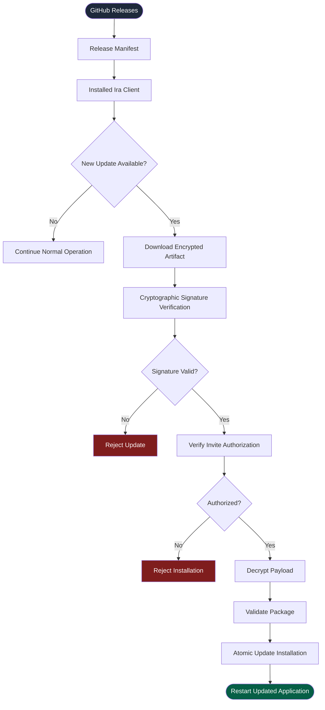

 <div align="center">

<!-- Animated Header -->


<!-- Typing Animation -->


<br/>

<!-- Main Badges -->
<p>


</p>

<p>


</p>

<br/>

**A private release infrastructure for Ira Assistant.**

*Secure distribution. Verified updates. Privacy-focused desktop intelligence.*

</div>

---

## 🔐 Restricted Access Notice

> [!CAUTION]
> **PRIVATE DISTRIBUTION — AUTHORIZED USERS ONLY**
>
> The release binaries hosted in this repository are not intended for public consumption.
>
> Release artifacts are encrypted at rest and cryptographically signed. Decryption and installation require an authenticated Ira Assistant installation and a personal cryptographic invite key issued by the owner.
>
> Downloading individual release artifacts manually will not provide a usable application.

---

## ⚡ 01. About Ira Assistant

**Ira Assistant** is a private, local-first, voice-locked desktop assistant engineered for Windows.

Designed to provide intelligent desktop interaction without depending on external cloud AI services or paid AI API keys.

It combines offline voice recognition, command execution, local intelligence, computer vision, and desktop automation into one unified assistant.

### ✨ Core Capabilities

| Feature | Description |
|:---|:---|
| 🎙️ Voice Intelligence | Offline wake-word detection, voice activity detection and speech recognition |
| 🌐 Multilingual Support | English, Hindi, Bengali, Hinglish and Banglish |
| 🔐 Voice Authentication | Owner-specific voiceprint verification |
| 🧠 Local Intelligence | Rules-first command processing with optional local SLM through Ollama |
| 🖥️ Desktop Automation | Application launching, browser workflows and desktop interactions |
| 👁️ Computer Vision | Local OCR and screen-based interaction |
| 🛡️ Security Engine | Risk-based action execution and encrypted audit logs |
| ↩️ Undo System | Reversible action journal for supported operations |
| 📦 Native Desktop Client | Python, PySide6, Qt and ONNX Runtime |
| 🔄 Auto Updates | Automated OTA update checking and installation |

<br/>

<div align="center">


</div>

---

## 🧬 02. Technology Stack

<div align="center">

### Core Technologies


### Intelligence & Processing


</div>

| Layer | Technology |
|:---|:---|
| Programming Language | Python |
| Desktop Interface | PySide6 / Qt |
| Machine Learning Runtime | ONNX Runtime |
| Speech Recognition | Whisper |
| Local Intelligence | Ollama (Optional) |
| Computer Vision | Local OCR and vision components |
| Distribution | GitHub Releases |
| Security | Cryptographic signing and encrypted artifacts |
| Testing | Automated test suite |

---

## 🔄 03. Automated OTA Update Architecture

This repository serves as the **private OTA update upstream** for authorized Ira Assistant installations.

Installed clients periodically check for new releases, validate update signatures, verify authorization and apply eligible updates.

### Update Lifecycle



### Update Security Pipeline

| Stage | Operation | Purpose |
|:---|:---|:---|
| 01 | Release Detection | Detect available versions |
| 02 | Signature Verification | Validate artifact authenticity |
| 03 | Invite Verification | Confirm installation authorization |
| 04 | Payload Decryption | Decrypt authorized artifacts |
| 05 | Package Validation | Check package integrity |
| 06 | Atomic Installation | Apply the verified update |
| 07 | Application Restart | Launch the updated client |

> [!IMPORTANT]
> **For Invited Users**
>
> If you have received an official Ira Assistant invitation, do not download release artifacts directly from the Releases tab.
>
> Your initial installation must use the dedicated bootstrap ZIP package and personal `.invite` certificate provided by the owner.
>
> After installation, the application can retrieve eligible future updates automatically.

---

## 🛡️ 04. Security & Privacy Architecture

Security is a fundamental part of Ira Assistant's distribution infrastructure.

### Security Principles

- **Private Distribution:** Access to installation packages is restricted to authorized recipients.
- **Cryptographic Verification:** Release packages must pass signature verification before installation.
- **Encrypted Artifacts:** Release payloads are encrypted at rest.
- **Invite-Based Authorization:** Personal invite certificates control installation authorization.
- **Local Processing:** Voice processing and supported intelligence operations run locally.
- **Privacy-Focused Design:** No personal voice recordings or machine identifiers are intentionally transmitted through the update-checking process.
- **Action Safety:** Risk-based execution controls protect sensitive desktop operations.

### Zero-Cloud AI Philosophy

<div align="center">


</div>

Ira Assistant is designed to minimize external dependencies and keep supported intelligence workflows on the user's device.

---

## 📦 05. Release Distribution

<div align="center">


</div>

### Distribution Model

| Component | Distribution |
|:---|:---|
| Bootstrap Installer | Private distribution |
| Personal Invite Certificate | Individually issued |
| Encrypted Release Artifacts | GitHub Releases |
| Update Manifest | OTA endpoint |
| Update Verification | Client-side verification |
| Installation | Authorized client |

### Release Workflow

```text
DEVELOPMENT
    |
    v
TESTING & VALIDATION
    |
    v
RELEASE PACKAGE GENERATION
    |
    v
ENCRYPTION & SIGNING
    |
    v
GITHUB RELEASE PUBLICATION
    |
    v
AUTHORIZED CLIENT UPDATE
```

---

## 📊 06. Project Quality

<div align="center">


<br/><br/>


</div>

---

## ⚖️ 07. Copyright & Proprietary License

**Copyright © 2026 Rahul Ghosh. All Rights Reserved.**

Ira Assistant and its associated source code, architecture, encrypted release artifacts, and distribution infrastructure are proprietary.

```text
PROPRIETARY SOFTWARE NOTICE

No permission is granted to use, copy, reproduce, reverse-engineer,
decompile, modify, merge, publish, distribute, sublicense, or share
this software or its encrypted release artifacts, in whole or in part,
without explicit written authorization from the copyright holder.

A cryptographically signed invite file issued by the owner constitutes
a non-transferable, revocable license solely for the individual named
within that invite, strictly for their personal, non-commercial use.

Unauthorized redistribution or use is prohibited.
```

---

## 👨‍💻 08. Project Maintainer

<div align="center">


<br/><br/>

**Rahul Ghosh**

*Developer & Creator of Ira Assistant*

<br/>

<a href="https://github.com/rahulghosh111111">

</a>

<br/><br/>

**Building private, intelligent and secure desktop experiences.**

<br/>


</div>
