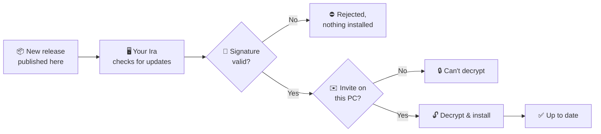

<div align="center">


</div>

> [!IMPORTANT]
> **This is the private release channel for Ira Assistant. The files here are not for public use.**
> Every release is signed and encrypted, and opens only in a copy of Ira whose owner has invited you (an invite file, sent to you personally). Downloading them gives you nothing usable.

> [!TIP]
> **Did the owner share Ira with you?** Install it from the **zip they sent you**, not from here. After that, your copy updates itself from this page. You never need to come back.

<p align="center"></p>

## 📑 Contents

| | | |
|---|---|---|
| 🎙️ [Meet Ira](#️-meet-ira) | 📦 [Install](#-install) | 🔄 [How it works](#-how-it-works) |
| 🗣️ [Talking to it](#️-talking-to-it) | 🖱️ [Clicking anything](#️-clicking-anything-on-screen) | ⏱️ [While something runs](#️-while-something-is-running) |
| 🖥️ [The app](#️-the-app) | 🔒 [Safety and privacy](#-safety-and-privacy) | 🚀 [Updates](#-updates-from-this-page) |
| 📁 [Your data](#-where-your-data-lives) | 🧭 [Not yet](#-not-yet) | ©️ [Copyright](#️-copyright) |

<p align="center"></p>

## 🎙️ Meet Ira

**Ira** is a voice-locked desktop assistant for Windows. It starts quietly with Windows. Say **“open assistant”** and it answers **“Yes boss, I'm here to listen to you”**. Your voiceprint is the key. Then talk to it in **English, Hindi, Bengali or a mix of them** until you say **“quit”**.

It opens apps, plays music, sets the volume, types, clicks buttons by name, sets reminders, reads you a morning brief and more. **Speech recognition, the voices and the voiceprint all run on your PC. Nothing you say leaves it.**

<div align="center">


<sub><b>Ira Assistant</b></sub>

<br><br>


<sub><b>Ira, still there</b></sub>

</div>

<p align="center"></p>

## 📦 Install

1. Unzip the file the owner sent you.
2. Double-click **`installer\Install.bat`**. You **don't need administrator rights**.
3. It installs on the signed python.org Python with hash-checked packages, and adds Start menu and desktop shortcuts and an entry in **Settings › Apps**.

To uninstall, use **Settings › Apps**. It asks whether to keep your data.

**On first start, the setup wizard** walks you through:

```text
🎤 microphone  →  🌐 language  →  ⬇️ model downloads  →  🗣️ your voiceprint (read a few sentences aloud)
              →  🔑 optional typed passphrase  →  🪪 Windows Hello test
```

Run it again any time from **tray › Set up…**.

<p align="center"></p>

## 🔄 How it works

<div align="center">

</div>

```text
sign in to Windows ──► it starts in the background: no window, no sound, just the tray icon
"open assistant" (or "ira kholo" / "ira khulo"), in your voice
      ──► "Yes boss, I'm here to listen to you."
      ──► it listens all the time, no wake phrase needed
            your voice + a command      ──► done, within about a second or two
            someone else / the TV       ──► ignored, silently
            you chatting with a friend  ──► ignored, silently ("Not a command" in the status line)
"quit" / "bye ira" / "stop bro" / Ctrl+L, or the laptop goes to sleep
      ──► back to waiting quietly for "open assistant"
```

<details>
<summary><b>🔓 Waking, staying, listening and going offline</b></summary>
<br>

- **Waking it:** while it waits, it says nothing to anyone, whatever is said in the room. Only “open assistant” in your voice wakes it. A near miss gets one more try (“Almost. Say a little more.”). Someone else saying the phrase counts as a failed attempt, and **3 failures block voice unlock for 2 minutes**, even across restarts. Change the phrase, greeting and mode in **Settings › Security** and **General**.
- **Staying with you:** it doesn't lock itself when you go quiet (Settings › General › “Lock after this many seconds of quiet”, 0 = never).
- **The window:** starting with Windows shows no window. Open it from the tray, the Start menu or the orb.
- **Listening:** while unlocked it listens continuously and acts only on your voice and only on commands. Settings › Voice › “Listening while unlocked: wake” switches back to “hey ira” / **Ctrl+Alt+J** with a short follow-up window.
- **Interrupting:** start talking while it speaks (with a headset), or say “hey ira” (on speakers).
- **Privacy mode:** tray › Mute microphone, or **Ctrl+Shift+P**, stops listening until you turn it back on.
- **Offline:** everything local keeps working, by voice and by typing. Commands that need the internet (weather, web search, email) answer “I'm offline”.

</details>

### ⚡ Speed

<div align="center">

</div>

It first uses a fast recognition model and re-checks with the more accurate one only if the fast model didn't find a command. It treats **0.45 s of silence** as the end of your sentence. Bengali is the slowest of the three because of its voice.

<p align="center"></p>

## 🗣️ Talking to it

<div align="center">

</div>

Everyday phrasing works in all three languages, including casual and rural spellings:

| 🇬🇧 English | 🇮🇳 Hindi / Hinglish | 🇧🇩 Bengali |
|---|---|---|
| open chrome · close it · switch to word | notepad khol do · chrome band karo | notepad kholo · chrome bondho koro |
| turn it down a bit · make it louder · mute | awaz thoda kam karo · awaaj badha do | awaj komao · awaj barao |
| put some music on · skip this song · pause | gaana laga do · agla gaana chalao · gaana band karo | gaan chalao · porer gaan · gaan bondho koro |
| what time is it right now · what's the weather | kitne baje hain · aaj mausam kaisa hai | kota baje · ajker abohawa kemon |
| remind me in 10 minutes to stretch | das minute baad paani peene ki yaad dilana | — |
| how are you · who are you · well done · good night | kaise ho · kya haal hai · tum kaun ho · bahut badhiya | kemon acho · ki khobor · tomar naam ki · khub bhalo |

- 💡 **Say it your way** *(since 1.10)*: you don't need the exact words. It understands “Can you lower the sound”, “गाना थोड़ी देर रोक दो” or “make this window full screen” by meaning, in a few milliseconds. If it's only fairly sure, it asks “Did you mean…?” and remembers your phrase when you say yes.
- 🔁 **Follow-ups and “it”** *(since 1.11)*: after a reply it keeps listening for 8 seconds. Examples: “open notepad” … “close it”; “search for flights to goa” … “open the second one” / “দ্বিতীয়টা খোলো”; “message ravi on whatsapp see you at five” … “do the same for rahul”; “again” / “phir se” / “abar”; “what did you just open?”; “forget this conversation”. Saying “thanks”, “bas” or “thik ache” ends the follow-up.
- 📂 **Your files** *(since 1.12, off until you switch it on in Settings › Files)*: “find the PDF about my car insurance” gives you the top 3 files, then say “open the first one”. Also: “what's the due date on my electricity bill?”, or “summarise this page / this PDF / my unread emails”, then “… in one line” or “… in detail”.

<details>
<summary><b>➕ More commands</b></summary>
<br>

take a screenshot · open youtube and play lofi · search for cheap flights · read my emails · send email to [name] · type hello · click OK · type hello into the search box · tick remember me · minimize all · reopen closed tabs · take a note … · lock computer · sleep · shutdown / restart / log off *(confirmed, with Windows Hello)* · undo that · privacy mode · **stop bro**

Say **help** for the full list. Add your own phrases in **Settings › Custom commands**: open an app or a website, run a shell command, or a sequence of steps. Phrases it gets wrong show up in **Activity › This week**, where you can turn them into test cases.

</details>

<p align="center"></p>

## ⏱️ While something is running

*Since 2026-11-03.* It keeps listening while a command runs, and new commands wait their turn in a queue.

| Say | What happens |
|---|---|
| **stop** · **cancel** · ruko · bas | Stops the running command, empties the queue and stops talking: “Okay, stopped.” With nothing running, “stop” pauses the music. |
| **stop talking** · **quiet** · shut up · chup | Stops the talking only. The command carries on. |
| a new command, under 10 s into the last one | “Got it, I'll do that next.” |
| a new command, 10 s or more into the last one | “I'm still working on your last command: … Skip it and start …? Yes or no?” |
| **stop bro** · quit | Stops everything and goes to sleep. |

A command that runs longer than **75 seconds** is stopped, and you're told.

<p align="center"></p>

## 🖱️ Clicking anything on screen

*Since 2026-11-03.* This works in any app and in browsers. It tries **UI Automation** first, then the page itself in the assistant's own browser, then **OCR** for apps that can't be read any other way.

| Say | What happens |
|---|---|
| click **how to learn** | Clicks “How to learn Python in 30 days”. The first three words of a label are enough, and close spellings work (“log in” = “login”, “2” = “two”). |
| click subscribe, *when there are two* | “I found 2 'Subscribe' buttons: one at the top and one at the bottom. Which one?” While you decide, the buttons are numbered on screen. Answer *top / bottom / first / number 2 / the one in the sidebar*… |
| click **the second button** · **the last tab** | By position only. |
| click **the search bar** | The field called Search. |
| **in Spotify click play** | Brings Spotify to the front first. |
| click something it can't find | “I couldn't find 'profile'. Did you mean A, B or C?” Your answer is clicked and remembered for that app. |
| click **Delete, Pay, Send, Uninstall, Sign out…** | Asks “Are you sure? Yes or no.” first. |

<p align="center"></p>

## 🖥️ The app

| | |
|---|---|
| 🪟 **Window** | The conversation, a box for typed commands (or your passphrase when locked), and an action card for everything it did, with **Undo** where possible. |
| 🔮 **Floating orb** | Shows listening / thinking / speaking and your mic level. Click to talk, double-click to open the window, drag to move it. It hides behind full-screen apps. |
| 🧷 **Tray** | Show the window, mute the microphone, lock, show the orb, set up, quit. |
| 📜 **Activity** | Everything it did, from the encrypted log, with filters. **This week** shows commands it didn't understand, your corrections and slow steps. |
| ⚙️ **Settings** | General, Voice, Microphone, Proactive, Security, Privacy, Updates, Safety, Custom commands, Contacts, Plugins. The interface comes in English, Hindi or Bengali, light or dark. |

<details>
<summary><b>☀️ Proactive: morning brief, meetings, email alerts</b> (all off until you turn them on)</summary>
<br>

- **Morning brief** at a time you choose: today's meetings, reminders, the weather and unread email.
- **Meeting reminders** from your calendar's secret iCal link (Google or Outlook.com), with a **Join** button for Teams / Zoom / Meet.
- **Email alerts** from people you mark as important.
- **Quiet hours**, and it waits while you present or are on a call. Ask “what did I miss?” or “why did you tell me this?” at any time.

</details>

<details>
<summary><b>🧩 Plugins</b></summary>
<br>

Plugins add commands and install from a `.zip` after a permissions prompt. Each one runs as its own program, and everything it does goes through the same safety checks as built-in commands. Plugins signed by someone other than Ira Assistant get a warning, and unsigned ones are refused. Plugins from Ira Assistant itself: **Notes** (“read my notes”), **Media** (“what's playing”, “spotify lofi beats”) and **WhatsApp** (“message Mum on WhatsApp hello”, always read back and confirmed).

</details>

<details>
<summary><b>🎧 Audio</b></summary>
<br>

| | Phone call (HD voice) | Ira |
|---|---|---|
| Sample rate | 16 kHz | 16 kHz |
| Low-cut filter | 80–100 Hz | 100 Hz |
| Echo cancellation, noise suppression | on | on |
| Automatic gain | on | optional (helps if you sit far away) |

“Clearer voice on laptop speakers” is on by default (Settings › Voice). It cuts the rumble small speakers can't play, lifts the speech range and keeps every sentence equally loud.

</details>

<p align="center"></p>

## 🔒 Safety and privacy

<div align="center">

</div>

- 🛡️ **One safety gate for every action.** Each command has a risk level. Risky ones are read back and confirmed by voice or with Yes / No, and No is the default. Shutdown, restart and log off also need **Windows Hello**.
- ↩️ **Undo.** “undo that”, or a card's Undo button, reverts the last 20 actions for 10 minutes.
- 🔐 **Encryption.** The voiceprint, the activity log's details and scheduled reminders are encrypted with **AES-256-GCM**. The calendar link is kept in Windows Credential Manager.
- 💻 **Local by default.** Speech recognition and the voices run locally. Crash reports stay on the PC, with paths, names, emails and anything you said removed.
- 🧬 **Replays and fake voices** *(since 1.13)*. Unlocking and risky spoken actions check that the voice is live. A recording of an earlier unlock is caught by its fingerprint, and when Ira is unsure it asks you to say a random phrase (“say: blue forty-seven”).
- 👨‍👩‍👧 **Family and guests** *(since 1.13)*. Family members get their own voiceprint and limits. Guest mode, off by default, lets unknown voices ask the time or the weather, ask a general question, or control music, and nothing else.
- 📂 **Your files, safely.** The file index is encrypted, password and key files are never read, and the model that summarises has no tools. Text inside a document can only ever become words in a summary.

> [!WARNING]
> Voice biometrics can still be fooled by a good enough voice clone. Treat voice unlock as a **convenience lock**, not a replacement for your Windows sign-in.

<p align="center"></p>

## 🚀 Updates from this page

Installed copies check this page and **update by themselves**. Updates are signed, and you can **go back to the previous version**.



| Layer | What it does |
|---|---|
| 🔏 **Signed** | Each release is signed by the owner. A tampered or unofficial file is refused. |
| 🔐 **Encrypted** | Release files can't be read without a valid invite. |
| ✉️ **Invite-bound** | Each invite is issued personally to a named person, for their own use. |
| ⏪ **Reversible** | You can go back to the previous version. |

<p align="center"></p>

## 📁 Where your data lives

<details>
<summary><b>Show folders</b></summary>
<br>

| Folder | Contents |
|---|---|
| `%APPDATA%\PersonalAssistant` | Settings, the encrypted voiceprint, the activity log (details encrypted), reminders and the brief, your custom commands and plugin data. Phrases you confirmed, the file index, family voiceprints and replay fingerprints (never audio) are all stored encrypted. |
| `%LOCALAPPDATA%\PersonalAssistant\Logs` | App logs and crash reports with personal details removed. |
| `%LOCALAPPDATA%\PersonalAssistant\Cache` | Downloaded models (speech, voices, wake phrase) and WordNet. |

</details>

<p align="center"></p>

## 🧭 Not yet

- **Synthetic-voice detector** (AASIST-L): optional. Without it, the replay check and the random-phrase challenge still work.
- **Separate settings and custom commands for family members:** members share the owner's settings and commands for now.
- **A signed installer for other PCs** (Microsoft Store / winget): evaluated, decision pending.
- **macOS:** only a plan. Windows is the platform today.

<p align="center"></p>

## ©️ Copyright

**Copyright © 2026 Rahul Ghosh. All rights reserved.**

No permission is given to use, copy, modify, share or distribute this software, in whole or in part, without the owner's written permission. An invite counts as permission for the person named in it, for their own use.

<div align="center">
<br>

</div>
